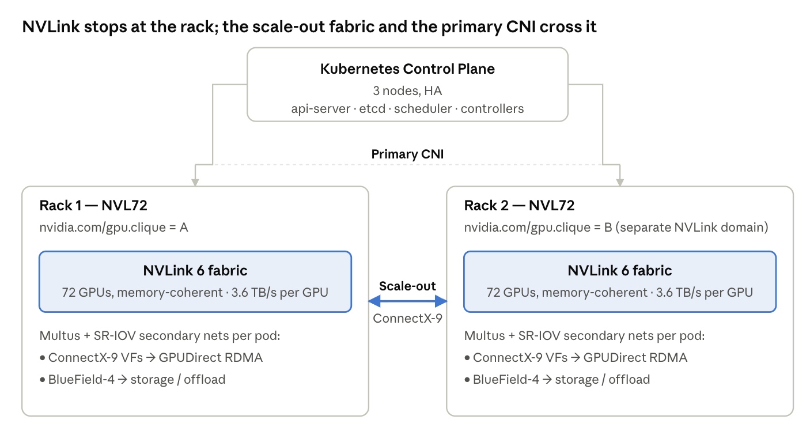

# Vera Rubin on Kubernetes — Architecture, Scheduling, and Open Source

## Customer intent and the questions

Since the introduction of NVIDIA Vera Rubin, my experience with those evaluating an NVL72 deployment are not buying hardware for headlines sake. They are buying a self-hosted frontier AI platform — their own equivalent of what Anthropic and OpenAI deliver centrally, where interactive chat, coding and research agents, deep-reasoning workflows, document and data processing pipelines, and specialized domain assistants are all served from one cluster behind the customer's own firewall — for two reasons that increasingly travel together.

The first is containing the **runaway hosted-API spend** that has eaten through the "blank check to get off the ground with AI" budgets of the past few years. Finance now wants a predictable cost ceiling and demonstrable ROI, not an open-ended per-token invoice that grows with every new use case. At a certain utlization query volume, dedicated hardware beats hosted-API pricing by a wide margin, and the delta grows with context length and query concurrency.

The second is **protecting IP** especially the proprietary data that is the customer's real competitive advantage. Enterprise AI value comes overwhelmingly from the data an organization has accumulated and curated over years: customer records, operational history, source code, strategy documents, clinical or client outcomes, trading patterns, domain-specific telemetry. The model has become a commodity; the data is and has been the moat. Keeping queries, documents, source code, and model weights on-premise means none of that moat traverses a third-party inference API or ends up as training signal in someone else's next model.

Both motivations point to the same architecture, and the capital expense only pencils out at near-continuous utilization — mixing production inference and scheduled training on the same cluster around the clock. In my previous life we enjoyed the problem of melting the systems around the 12 month mark because utilization was 24/7. Everything downstream in this doc ties back to those two intents.

Four technical questions determine whether the architecture actually delivers on that intent. The first two are the ones most often run together in customer planning conversations.

1. **Sizing.** Can one workload span multiple racks? The frontier models a customer wants to run or train *may exceed* a single rack's 72-GPU NVLink domain.
    - Short answer: spanning works, but NVLink is a hard rack boundary and parallelism has to be designed around it.

2. **Resilience.** What happens when a node fails mid-run? A 144-GPU training job that loses a node 36 hours in cannot start over from zero.
    - Short answer: pods do not migrate (Kubernetes is not vMotion). They are killed and rescheduled, and the ML framework resumes from its last checkpoint on new topology-aligned nodes.
    
    TODO is vMotion capability of preventing a restart from restart or checkpoint?

3. **Utilization.** How do we keep GPUs saturated 24/7? Mixing production inference and scheduled training on the same cluster without starving either is the lever that justifies the capex.
    - Short answer: priority-class gang scheduling (Kueue), evictable training jobs that backfill idle inference capacity, strict multi-tenancy.

4. **Portability.** Are we locking into one vendor's stack? Customers spending this much want to own their stack, not rent it from a single vendor.
    - Short answer: every component in the critical path is Apache 2.0; the proprietary pieces are either hardware-adjacent or optional value-add on top.

Alongside those four, **a fifth question sits above them all** and comes up in almost every planning conversation: is Kubernetes the right scheduler to deliver these use cases at all? Slurm still dominates frontier AI research labs, and some teams would rather skip the orchestration layer entirely with managed cloud services. 
    - Short answer: for an enterprise self-hosted AI platform — where the workload is a mix of inference, training, and the surrounding application plane that serves many consumers 24/7 — Kubernetes is the dominant pattern today. The alternatives win in specific niches but miss the full enterprise-platform picture. Addressed in depth in its own section alongside the hypervisor question.

    TODO can you verify Slurm still dominates frontier AI research?
    TOO can you verify K8s is the dominate pattern?

The rest of this post works each question in turn: a fabric-topology picture, two concrete scenarios (36-GPU and 144-GPU jobs), the parallelism strategy that makes spanning work, failure handling, the 24/7 saturation pattern that drives the whole business case, the common misconception that Kubernetes itself is the limiting factor, the related meta-questions of whether Kubernetes is the right technology at all and whether to run it on a hypervisor, like vSphere, the 100% open source stack that makes everything work (and the narrow set of pieces that stay proprietary), takeaways for architects, and finally the alternative hardware paths if Vera Rubin itself is not the right fit.

## The fabric picture

Three network planes to keep straight:

1. The primary CNI (Cilium, Calico, or OVN-Kubernetes) handles ordinary pod-to-pod traffic cluster-wide.

1. NVLink is intra-rack only — 72 GPUs form one memory-coherent domain per rack and the fabric physically ends at the rack.

1. The scale-out ConnectX-9 fabric (Spectrum-X Ethernet or Quantum-X800 InfiniBand) carries everything that crosses racks, including GPUDirect RDMA for distributed training.

## Scenario 1: 36-GPU training job fits in one rack

36 Rubin GPUs give roughly 10 TB of HBM4 (high-bandwidth memory stacked beside each GPU for maximum throughput) inside one NVLink domain. That footprint comfortably holds workloads like:

1. meta-llama/Llama-3.1-405B — frontier general-purpose reasoning (code generation, agentic workflows, deep analysis of long documents). Full fine-tune with FSDP (Fully Sharded Data Parallel — PyTorch's technique for splitting weights, gradients, and optimizer states across GPUs); 810 GB of bf16 weights plus optimizer states fit with room for aggressive sequence lengths.

1. deepseek-ai/DeepSeek-V3 — frontier reasoning with cheap inference economics. 671B parameters total but only 37B active per token (Mixture of Experts: only a subset of expert sub-networks fire per inference step). Full fine-tune or continued pretraining fits with room to spare.

1. mistralai/Mixtral-8x22B — the enterprise fine-tune sweet spot for coding assistants, reasoning agents, and multilingual applications. Long-context fine-tune with headroom.

1. Qwen/Qwen2.5-72B — strong coding and multilingual coverage; the trivial fit at this GPU count leaves room for very long context windows and large batch sizes.

1. High-throughput inference serving any of the above as a self-hosted assistant with a large KV cache (per-conversation attention state kept hot in GPU memory), supporting hundreds to thousands of concurrent users on one rack.

Above are examples of capable models discussed where the country of origin is a factor in the model decision.

At scheduling time, the gang scheduler reads the `nvidia.com/gpu.clique` label that the NVIDIA GPU Operator applies to every node sharing an NVLink domain. All 36 pods land on nodes within clique A. Every GPU-to-GPU collective runs at NVLink speeds — 3.6 TB/s per GPU on Rubin. No cross-rack traffic, no fabric transitions, no parallelism gymnastics required.

TODO what does the `nvidia.com/gpu.clique` label do differently?

## Scenario 2: 144-GPU training job must span two+ racks

144 Rubin GPUs give ~41 TB of HBM4 across two NVLink domains. That is frontier-pretraining territory — building (or heavily specializing) a self-hosted model that will serve as the customer's own ChatGPT or Claude equivalent:

1. Pretraining a Llama-3.1-405B-class dense model from scratch — the "build your own frontier assistant" path. Suitable when the customer wants complete control over data provenance, training objectives, and alignment, and has the multi-trillion-token corpus to justify it.

1. Pretraining a DeepSeek-V3-class 600B+ MoE on fresh corpora — same end goal (self-hosted frontier assistant) with cheaper per-token inference economics via Mixture of Experts, at the cost of a more complex training recipe.

1. Training a ~1T parameter dense model where neither tensor parallelism alone nor data parallelism alone is sufficient. Research territory for customers pushing beyond current open weights.

1. Large-scale continued pretraining of openai/gpt-oss-120b (or similar strong open base) with extended context and heavy data parallelism — the pragmatic path to a self-hosted frontier assistant: start from a strong open base, specialize it on the customer's own domain corpus, and keep weights, data, and queries on-premise.

72 GPUs is the hard NVLink boundary. There is no way to extend a single NVLink domain across two NVL72 racks — the fabric physically ends at the rack. A 144-GPU job touches two `cliques` (A + B), and those two cliques communicate over the scale-out ConnectX-9 fabric (Spectrum-X Ethernet or Quantum-X800 InfiniBand) at 1.6 Tb/s per GPU.

That is roughly a 20x bandwidth drop versus intra-rack NVLink. The answer is not "don't span racks." The answer is to design the parallelism so that the 20x cliff lands on the right traffic.

TODO how do you "design the parallelism"?

## Parallelism strategy aligned to the fabric hierarchy

The principle: put the chattiest collectives on the fastest fabric. For a spanning job, that maps cleanly onto three parallelism dimensions:

TODO what is an example of "chattiest collectives"?

### Training parallelism

1. **Tensor parallel INSIDE each rack.** Every forward and backward pass triggers an all-reduce across the tensor-parallel group. These are the chattiest collectives, so they stay on NVLink.

1. **Pipeline parallel ACROSS racks.** Activation hand-offs between pipeline stages are far less chatty than tensor-parallel all-reduces. They tolerate the drop to ConnectX-9 speeds and run over GPUDirect RDMA.

NCCL (NVIDIA Collective Communications Library — the low-level GPU-to-GPU communication layer used by every ML framework) handles the fabric switching transparently. You tell your training framework (PyTorch FSDP, Megatron-LM, DeepSpeed) which parallelism dimension maps to which process group, and the gang scheduler places each process group on topology-aligned nodes using the clique labels. The NVIDIA DRA (Dynamic Resource Allocation — the Kubernetes 1.34 GA mechanism for exposing structured hardware resources beyond simple device counts) driver exposes NVLink cliques as ComputeDomain objects, so the scheduler treats "these 72 GPUs are memory-coherent" as a first-class scheduling constraint.

TODO does vLLM and llm-d use NCCL?

**Spanning works.** It just stops being free above 72 GPUs. The architect's job is making sure the 20x bandwidth cliff lands on the right traffic.

### Inference parallelism

Inference uses gang scheduling too, with a different purpose. For training, gang scheduling means "all N pods of this one job start together or none start" — the all-reduce collective requires every worker present. For inference, it means "all K GPUs of one serving replica are allocated atomically." You cannot have half a replica of a 405B model — vLLM distributing a model across 8 GPUs with tensor parallelism needs all 8 GPUs to initialize simultaneously or the serving pod cannot start at all. KServe plus Kueue (or KAI Scheduler) handles this: the inference deployment declares its GPU resource request as a group, and the scheduler either places all K GPUs on topology-aligned nodes or waits.

TODO are there other projects to consider Kueue (or KAI Scheduler)?

Topology constraints carry over. A tensor-parallel serving replica wants its K GPUs on one NVLink domain for the all-reduce traffic on every forward pass. **Where training runs one gang-scheduled job across many GPUs, inference runs many parallel gang-scheduled replicas of the same model, each smaller (typically 8–16 GPUs) and scaling up and down based on queue depth.** The scheduler has to pack multiple inference replicas plus optional training jobs onto a rack without fragmenting the NVLink domain, which is where topology-aware placement earns its keep.

Does K8s do topology-aware placement natively? This seems important to justify K8s as the dominate technology previously stated.

## When a worker node fails: training vs inference

Gang-scheduled jobs do not partially restart. If one worker in a 36- or 144-GPU job dies, the collective is broken and the whole job terminates. The sequence is:

1. The failed pod goes away; the scheduler detects the gang is incomplete.

2. Kueue (or Volcano, or KAI) requeues the entire workload.

TODO is there a better way to refer to projects like Kueue (or Volcano, or KAI)?

3. The ML framework resumes from its last checkpoint — this is a framework-level responsibility (PyTorch DCP, DeepSpeed, Megatron-LM checkpointing), not a Kubernetes responsibility.

4. The scheduler finds a healthy set of nodes within a single NVLink clique (for ≤72 GPU jobs) or two cliques (for the 144-GPU case) and lands the job there.

This is what customers often mean when they say "pod migration." It is really checkpoint-and-restart on a new, topology-aligned set of nodes. Nothing about the pod itself survives the move; the state that matters lives in the checkpoint on shared storage.

TODO I head checkpointing has matured on K8s is this true? if so what projects/features?

**Practical implication:**

During training, the quality of the customer's checkpointing strategy — frequency, storage bandwidth, restore time — matters more for operational uptime than any Kubernetes feature. A 10-minute checkpoint cadence on a 48-hour job means a worst-case 10 minutes of lost work per failure, not a 48-hour restart.

Inference resilience is a different story. The checkpoint-and-restart pattern above is for long-running training jobs. Inference workloads have different failure characteristics and need different architectural answers.

## What inference loses on a failure:

1. At the request level, inference is stateless. A pod failure causes transient 5xx errors for in-flight requests; new requests route to healthy replicas; users see a blip, not an outage.

TODO what is a real world example using Anthropic of this?

1. At the replica level, failure costs serious warm state. The KV cache (per-conversation attention state in GPU memory), the prefix cache (shared system prompts and tool definitions, which drive 2–5x throughput on agent-heavy loads), and the loaded model weights all evaporate.

1. Model reload is slow. A 405B model in FP8 is roughly 405 GB of weights that have to be read from storage into GPU HBM across all tensor-parallel ranks. Cold-start is minutes, not seconds. For a platform where users and agents expect sub-second latency, a replica coming back online cold is a visible interruption.

1. Rack-level failure is where it gets serious. Losing a full NVL72 rack hosting an inference deployment takes down everything on that rack. This is the single biggest argument for two-or-more-rack deployments — you cannot checkpoint-and-restart out of a user-visible outage.

Architectural answers for inference resilience (different from training):

1. N+1 replica design at the serving layer — multiple vLLM replicas across different nodes and ideally different racks behind one KServe endpoint, load balancer routing around failures.

1. Pre-warmed standby replicas for frontier models — the cold-start cost makes "scale from zero on demand" the wrong pattern for primary inference. Keep spares warm.

1. Prefix cache replication or regeneration strategy — push shared prefixes (system prompts, tool definitions, long document context) to a shared cache tier so cold replicas warm up fast.

1. Session affinity with graceful fallback — route a conversation to the same replica when possible for KV cache reuse; fall back to any healthy replica with full re-ingestion when the sticky target is unavailable.

1. Multi-rack deployment as the SLA mechanism — the two-rack and four-rack sizing described in the 24/7 saturation section is not just about model variety and context length. It is also about inference redundancy. One rack failing cannot take the platform down.
