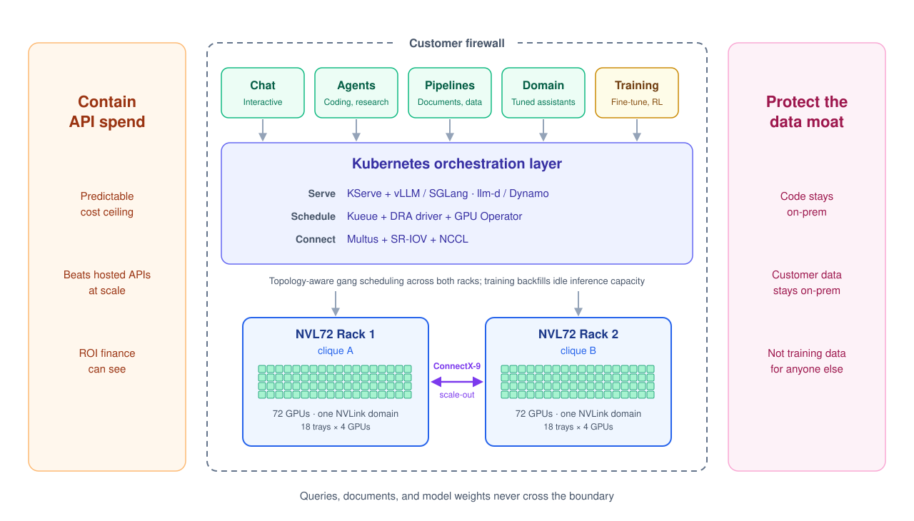
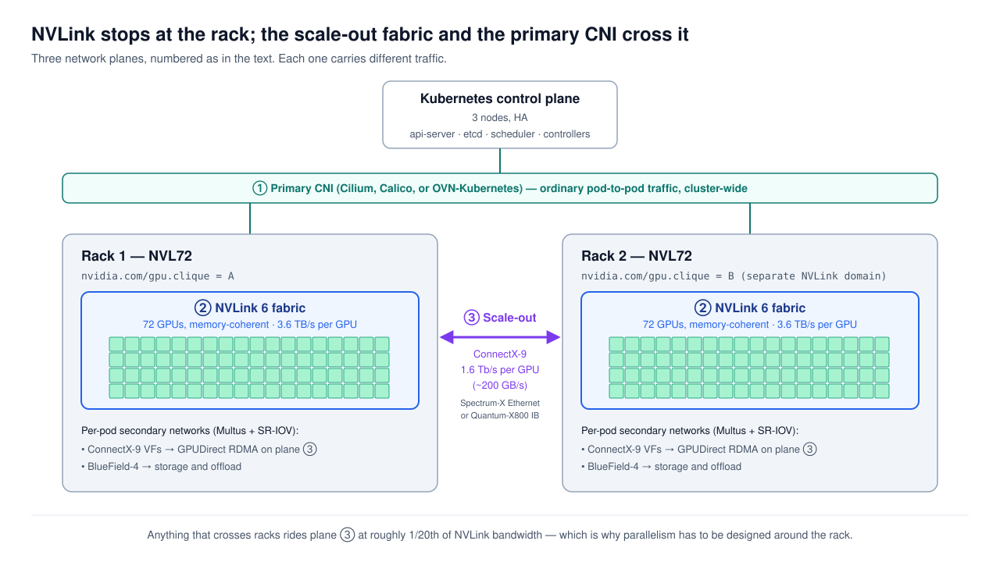
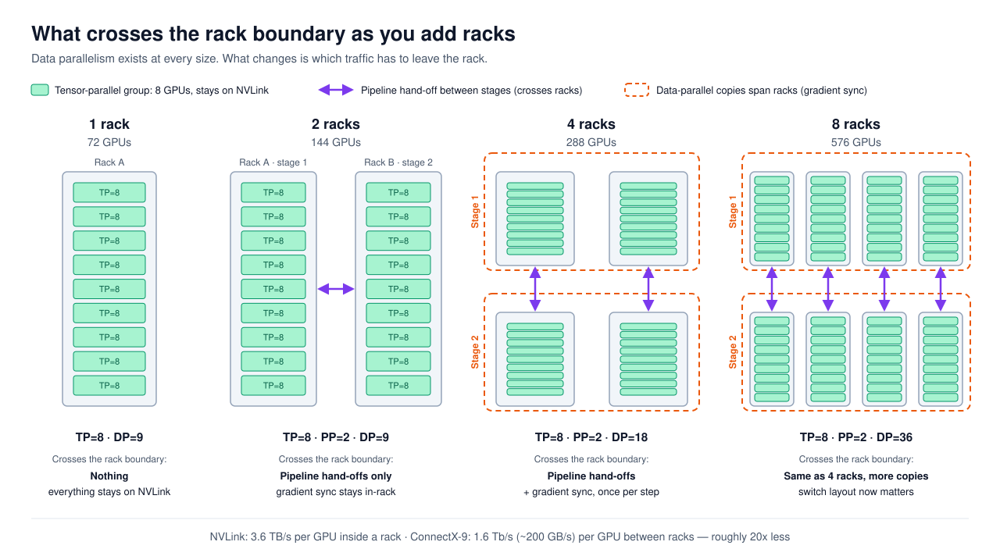

# Kubernetes on Vera Rubin — Architecture, Scheduling, and Open Source

## Customer intent and the questions

Since the introduction of NVIDIA Vera Rubin, my experience with those evaluating an NVL72 deployment has been more rigorous than most systems to date, like the NVIDIA SuperPOD. What is the planned purpose for such an investment? A self-hosted frontier AI platform — a completely contained equivalent of what Anthropic and OpenAI deliver centrally, where interactive chat, coding and research agents, deep-reasoning workflows, document and data processing pipelines, and specialized domain assistants are all served from one cluster behind the customer's own firewall — for two reasons that increasingly travel together.

The first is containing the **runaway hosted-API spend** that has eaten through the "blank check to get off the ground with AI" budgets of the past few years. Finance now wants a predictable cost ceiling and demonstrable ROI, not an open-ended per-token invoice that grows with every new use case. Above a certain query volume, dedicated hardware beats hosted-API pricing by a wide margin even with current cost of hardware rising, and the delta grows with context length and query concurrency.

The second is **protecting IP** — especially the proprietary data that is the customer's real competitive advantage. Enterprise AI value comes overwhelmingly from the data an organization has accumulated and curated over years: customer records, operational history, source code, strategy documents, clinical or client outcomes, trading patterns, domain-specific telemetry. The model has become a commodity; the data is and has been the moat. Keeping queries, documents, source code, and model weights on-premise means none of that moat traverses a third-party inference API or ends up as training signal in someone else's next model.

Both motivations point to the same architecture, and the capital expense only pencils out at near-continuous utilization — requiring a mixture of production inference and scheduled training on the same cluster around the clock. In my previous life, we enjoyed the problem of melting the systems around the 12 month mark because utilization was 24/7. Everything downstream in this doc ties back to those two intents.

Five technical questions determine whether the architecture actually delivers on that intent. The first three are the ones most often run together in customer planning conversations.

1. **Orchestration.** Is Kubernetes the right scheduler to deliver these AI use cases, or do other schedulers and hypervisors earn a place alongside or instead of it?

    Short answer: it depends on the system’s purpose.

    - For enterprise self-hosted AI platforms — where the workload is a mix of inference, training, and the surrounding application plane serving many consumers 24/7 — Kubernetes is the dominant pattern today.

    - For pure training, Slurm is still the most common scheduler — it runs roughly two-thirds of the TOP500 — but the frontier labs are split: OpenAI has trained on Kubernetes since the GPT-3 era, Meta trained Llama 3 on its own scheduler (MAST), and Mistral runs Slurm on top of Kubernetes. The trend is convergence, not a winner: NVIDIA now owns both Slurm's developer (SchedMD) and Run:ai, and Slurm-on-Kubernetes projects (Slinky, SUNK) give researchers Slurm's job interface on a Kubernetes-managed cluster.

    - Hypervisors earn their place around the GPU racks, not on them. Two cases come up most: large multi-socket CPU servers, where splitting one host into a VM per socket gives Kubernetes right-sized nodes with local memory instead of one oversized node; and teams with deep hypervisor experience but no bare-metal Kubernetes practice, who can run the application plane (gateways, auth, observability, vector databases) on infrastructure they already operate. The GPU racks run bare-metal Kubernetes either way. Addressed in its own section below; on 8-GPU servers, below rack scale, virtualizing the GPU hosts is also a supported option (see Alternatives).

    The alternatives win in specific niches but miss the full enterprise-platform picture.

1. **Sizing.** Can one workload span multiple racks? Large training jobs often want more GPUs than a single rack’s 72-GPU NVLink domain — less to fit the model in memory than to finish in a reasonable time.

    Short answer: spanning works, but NVLink is a hard rack boundary and parallelism has to be designed around it. Chatty collectives stay inside one rack on NVLink; less chatty ones cross racks on the scale-out fabric.

1. **Resilience.** What happens when a disruption hits mid-run — a node failure, a rack outage, a network partition? A 144-GPU training job that loses a node 36 hours in cannot start over from zero.

    Short answer: Kubernetes pods do not live-migrate between racks on failure, and no orchestrator could, because GPU state cannot be streamed between hosts the way CPU memory can. On an unplanned node failure the pod is killed, rescheduled, and the ML framework resumes from its last checkpoint on new topology-aligned nodes.

    GPU portability has advanced significantly over the past 18 months — cuda-checkpoint, CRIUgpu, NVIDIA Dynamo Snapshot — but production-ready operation today is stop-the-world checkpoint and restore in seconds, not live-streaming migration in milliseconds. Different quality of operation than vMotion, and not applicable to rack-scale NVLink workloads yet.

1. **Utilization.** How do we keep GPUs saturated 24/7? Mixing production inference and scheduled training on the same cluster without starving either is the lever that justifies the capex.

    Short answer: priority-class gang scheduling (Kueue), evictable training jobs that backfill idle inference capacity, and strict multi-tenancy.

1. **Portability.** Are we locking into one vendor’s stack? Customers spending this much want to own their stack, not locked into a single vendor in the rapidly evolving science project.

    Short answer: every component in the critical path should start with Apache 2.0 open source; the enterprise-supported and proprietary pieces are either hardware-adjacent or optional value-add on top.

The rest of this post works each question in turn: a fabric-topology picture, two concrete scenarios (36-GPU and 144-GPU jobs), the parallelism strategy that makes spanning work, failure handling, the 24/7 saturation pattern that drives the whole business case, the common misconception that Kubernetes itself is the limiting factor, the related meta-questions of whether Kubernetes is the right technology at all and whether to run it on a hypervisor like vSphere, the 100% open source stack that makes everything work (and the narrow set of pieces that stay proprietary), takeaways for architects, and finally the alternative hardware paths if Vera Rubin itself is not the right fit.

## The fabric picture

Three network planes to keep straight:

1. The primary CNI (Cilium, Calico, or OVN-Kubernetes) handles ordinary pod-to-pod traffic cluster-wide.
2. NVLink is intra-rack only — 72 GPUs form one memory-coherent domain per rack (NVIDIA's term for the NVL72 architecture, where GPUs share a unified memory address space over the NVLink fabric), and the fabric physically ends at the rack.
3. The scale-out ConnectX-9 fabric (Spectrum-X Ethernet or Quantum-X800 InfiniBand) carries everything that crosses racks, including GPUDirect RDMA for distributed training.

## Scenario 1: 36-GPU training job fits in one 72-GPU rack

36 Rubin GPUs give roughly 10 TB of HBM4 (high-bandwidth memory stacked beside each GPU for maximum throughput) inside one NVLink domain. That footprint comfortably holds workloads like:

- **meta-llama/Llama-3.1-405B** — frontier general-purpose reasoning (code generation, agentic workflows, deep analysis of long documents). Full fine-tune with FSDP (Fully Sharded Data Parallel — PyTorch's technique for splitting weights, gradients, and optimizer states across GPUs). A standard full fine-tune needs about 16 bytes per parameter for weights, gradients, and optimizer state — roughly 6.5 TB for 405B — which leaves about 4 TB for activations and long sequences.
- **deepseek-ai/DeepSeek-V3** — frontier reasoning with cheap inference economics. 671B parameters total but only 37B active per token (Mixture of Experts: only a subset of expert sub-networks fire per inference step). This is the one model on the list that does *not* get a standard full fine-tune at 36 GPUs: at 16 bytes per parameter it needs about 10.7 TB of training state, slightly more than the ~10.4 TB available. A full fine-tune or continued pretraining wants the whole 72-GPU rack (~21 TB); a parameter-efficient fine-tune (LoRA, which trains small adapter weights and leaves the base model frozen) fits at 36 GPUs easily.
- **mistralai/Mixtral-8x22B** — the enterprise fine-tune sweet spot for coding assistants, reasoning agents, and multilingual applications. 141B parameters is about 2.3 TB of training state, so a long-context fine-tune has plenty of headroom.
- **Qwen/Qwen2.5-72B** — strong coding and multilingual coverage. About 1.2 TB of training state; the easy fit at this GPU count leaves room for very long context windows and large batch sizes.

Inference sizing for the same models is covered separately in the “How many of these models fit on one rack?” section below, under the 24/7 saturation discussion.

Above are examples of capable models discussed where the country of origin is a factor in the model decision.

At scheduling time, the NVIDIA GPU Operator has already labeled every node with `nvidia.com/gpu.clique` — a topology marker that identifies which NVLink domain the node's GPUs belong to. All 18 nodes in one NVL72 rack share the same clique ID; nodes in a different rack get a different one. This is the critical distinction from the familiar `nvidia.com/gpu.count` label: `gpu.count` tells you *how many* GPUs a node has, `gpu.clique` tells you *which other GPUs they can reach at NVLink speeds*.

A gang scheduler reads `gpu.clique` as a hard placement constraint. For a 36-GPU job, it finds a clique with 36 available GPUs and places every pod of the job inside that clique — typically one pod per 4-GPU compute tray, so nine pods.

The result: every GPU-to-GPU collective runs at NVLink speeds — 3.6 TB/s per GPU on Rubin. No cross-rack traffic, no fabric transitions, no parallelism gymnastics required.

Can Kubernetes do this today? Yes.

What else is needed? NVIDIA GPU Operator (clique labeling), a gang scheduler (Kueue, Volcano, or KAI), and a training launcher (torchrun, Kubeflow Training Operator, or KubeRay). All open source, all shipping today.

## Scenario 2: 144-GPU training job must span two racks

144 Rubin GPUs give ~41 TB of HBM4 across two NVLink domains. Memory is rarely the reason to go this big — Scenario 1 showed that a 405B full fine-tune fits in half a rack. The reasons to span two racks are speed and workload shape:

- **Continued pretraining of a strong open base** — openai/gpt-oss-120b, Llama-3.1-405B, or DeepSeek-V3, specialized on the customer's own domain corpus. This is the pragmatic path to a self-hosted frontier assistant: a few hundred billion tokens of the customer's data rather than the ~15 trillion a from-scratch run needs, which keeps the job in days-to-weeks territory and keeps weights, data, and queries on-premise.
- **Reinforcement learning (RLHF, RL from verifiable rewards).** RL runs inference (generating candidate answers) and training (updating the model) at the same time, so it naturally wants more GPUs than a plain fine-tune of the same model.
- **Pretraining a DeepSeek-V3-class MoE from scratch.** MoE is cheap to train for its size because only ~37B parameters work on each token. DeepSeek reported about 2.8 million H800 GPU-hours for V3. Assuming each Rubin GPU does the work of 5–10 H800s, 144 GPUs would take roughly three to six months — aggressive, but possible, if the customer has a multi-trillion-token corpus.

What 144 GPUs cannot realistically do is pretrain a 405B-class *dense* model from scratch. Llama-3.1-405B took about 31 million H100 GPU-hours. Even assuming each Rubin GPU does the work of 5–10 H100s, 144 GPUs would need two to five years. Dense frontier pretraining is a thousands-of-GPUs job. The rule of thumb: memory decides whether a model fits; compute decides whether you finish.

72 GPUs is the hard NVLink boundary. There is no way to extend a single NVLink domain across two NVL72 racks — the fabric physically ends at the rack. A 144-GPU job therefore has to touch two cliques (A + B), and the traffic between them drops onto the scale-out ConnectX-9 fabric (Spectrum-X Ethernet or Quantum-X800 InfiniBand) at 1.6 Tb/s per GPU — about 200 GB/s, versus 3.6 TB/s on NVLink. That is roughly a 20x bandwidth drop versus intra-rack NVLink — and it is the moment where parallelism design stops being optional. The answer is not "don't span racks." The answer is to design the parallelism so that the 20x cliff lands on the right traffic.

Can Kubernetes do this today? Yes.

What else is needed? Everything from Scenario 1, plus the NVIDIA DRA Driver (ComputeDomains for cross-rack topology awareness), Multus CNI, and the SR-IOV Network Operator for GPUDirect RDMA over the ConnectX-9 fabric. DRA went GA in Kubernetes 1.34 and the pieces have all landed in the last 18 months.

## Parallelism strategy aligned to the fabric hierarchy

### Primer on parallelism

Parallelism is the general technique of splitting a workload across many GPUs so it finishes faster or so it fits where it otherwise would not. It exists because frontier models are too large for a single GPU — a 405B model in FP8 is roughly 405 GB of weights, and a Rubin GPU has 288 GB. Something has to split the model across GPUs. That something is a parallelism strategy, and it decides *how* the split happens: which GPU holds what, which GPUs talk to which, and when.

**In training.** Parallelism splits a single large job across many GPUs so the whole job runs together as one coordinated unit. The three dimensions you'll see named — tensor, pipeline, and data — are three different *axes* along which the split can happen, and real training jobs use all three at once. Tensor parallelism splits each layer's math across GPUs; pipeline parallelism splits the sequence of layers across GPUs; data parallelism splits the training data across GPUs that each hold the same model. The job runs on all of them simultaneously, and they coordinate through collectives like all-reduce.

**In inference.** Parallelism splits one serving replica across the GPUs it needs to hold the model. A 405B model at FP8 is about 405 GB, so on 288 GB Rubin GPUs it needs at least 2 GPUs just to fit, and usually 4 to leave room for the KV cache — tensor parallelism is doing the splitting. (Training the same model needs far more memory, because gradients and optimizer state come along too.) But unlike training, inference does not run one coordinated job across the whole cluster. Instead, it runs many *independent* replicas in parallel, each one serving its own stream of requests. The parallelism inside a replica is the same primitive as training's tensor parallelism; what's different is that the replicas themselves don't coordinate with each other.

The unit of measure is different in training and inference, and it drives everything else about how the architecture is sized and scheduled. **Training schedules one large job that grows as rack count grows** — tensor-parallel groups inside each rack, pipeline stages across racks, data-parallel replicas wrapping the whole topology. **Inference schedules many small replicas that multiply as rack count grows** — each replica is a self-contained serving unit of typically 2 to 8 GPUs on Rubin, independent of the others, scaling up and down with queue depth. (MoE models served with wide expert parallelism are the exception and can span a whole rack.)

Both use the same primitives (tensor parallelism, gang scheduling, NVLink-aware placement). What differs is whether the primitive is doing coordination inside one giant workload or isolation around many small ones.

### Primer on all-reduce

The fabric placement decision in the rest of this section hinges on what an all-reduce actually does. In one sentence: every participating GPU contributes a tensor, the tensors are combined (summed, averaged) across all participants, and every GPU ends up with a copy of the combined result. "Reduce" is combining; "all" means every participant ends up with the combined output. It is the primitive that keeps GPUs in sync during distributed training.

Tensor parallelism uses it on every layer to combine partial activation results from GPUs that are splitting one layer's math. Pipeline parallelism does not use all-reduce at all — it uses point-to-point sends between adjacent stages, which is a much lighter primitive. Data parallelism uses all-reduce once per step to average gradients across replicas. The frequency and size of these operations is what makes some parallelism dimensions chatty and others not — and therefore what makes the fabric placement decision matter.

Inference uses all-reduce too, and in production often uses it more than training does. A tensor-parallel serving replica runs two all-reduces on every layer (one after attention, one after the MLP) of every **forward pass** — the forward pass being one trip through the model's layers to produce a single output token. Frontier models are deep: Llama-3.1-405B has 126 layers. Generating a 1,000-token response from Llama-3.1-405B therefore triggers roughly 250,000 all-reduces across the TP group, and every one of them lands directly in user-visible latency.

Training can tolerate occasional slow collectives because the overall step is seconds long — a 5ms hiccup inside a 10-second step is invisible. Inference cannot: tokens arrive one at a time at human-visible speed, and every slow collective shows up as sluggish typing from the user's perspective. The slow collectives are not occasional either — they repeat on every one of those 250,000 operations, so a small per-collective penalty becomes the dominant cost line item in serving latency.

The fabric placement decision therefore applies at least as strongly to inference workloads, which is the shape most Vera Rubin deployments actually run around the clock.

### Matching collectives to the fabric

The principle is simple: put the chattiest collectives on the fastest fabric. The hard part is knowing which collective is the chattiest, and by how much.

In distributed training, the chattiest collective by a wide margin is the **tensor-parallel all-reduce**. Training a 405B model like Llama-3.1-405B typically splits the work across many GPUs in three dimensions at once: tensor parallelism (chunks of each layer, usually across 8 GPUs), pipeline parallelism (sequential model stages, often across racks), and data parallelism (copies of the whole arrangement, synchronized once per step). Within a tensor-parallel group, each layer triggers two all-reduces on the forward pass and two more on the backward pass. Llama-3.1-405B's 126 layers mean roughly 500 all-reduces per micro-batch, each moving a few hundred megabytes of activations at an 8K sequence length — hundreds of gigabytes of traffic per training step.

Why 8 GPUs per tensor-parallel group, when NVL72 has 72 on NVLink? On older 8-GPU servers, NVLink stopped at the server, so 8 was a hard limit. On NVL72 every GPU in the rack reaches every other GPU at full NVLink speed through the NVLink switch trays, so the server boundary (4 GPUs per compute tray) no longer matters — the rack boundary does. Tensor parallelism stays around 8 anyway for a software reason: splitting each layer into more pieces makes every piece too small to keep a GPU busy, while each all-reduce gets more expensive. NVL72's extra NVLink reach goes to expert parallelism in MoE models and to data-parallel groups that stay inside the rack.

The other parallelism dimensions are far less demanding. Pipeline parallelism exchanges activations between stages on each micro-batch boundary — many small transfers, each carrying one activation tensor. Data parallelism synchronizes gradients just once per step; the transfer is large but infrequent. Tensor parallelism dominates the total bandwidth demand per training step, with pipeline parallelism distantly second and data parallelism a distant third — which is what makes the fabric placement decision obvious: tensor-parallel traffic has to stay on NVLink, and the other dimensions can tolerate the scale-out fabric.

For a spanning job, the principle maps cleanly onto three parallelism dimensions:

1. **Tensor parallel INSIDE each rack.** Every forward and backward pass triggers all-reduces across the tensor-parallel group. These are the chattiest collectives, so they stay on NVLink. On NVL72 any 8 GPUs in the same rack qualify, even across compute trays — the boundary that matters is the rack, not the server.
2. **Pipeline parallel ACROSS racks.** Activation hand-offs between pipeline stages are far less chatty than tensor-parallel all-reduces. They tolerate the drop to ConnectX-9 speeds and run over GPUDirect RDMA.
3. **Data parallel wraps everything else.** Once one copy of the model is laid out with tensor and pipeline parallelism, every remaining GPU becomes another data-parallel copy: total GPUs ÷ (TP × PP). With TP=8 and PP=2, 144 GPUs give 9 copies, 288 give 18, and 576 give 36. Gradient synchronization happens once per step, so data-parallel groups tolerate the slowest links in the topology.

Can Kubernetes do this today? Yes, but the parallelism design itself lives in the training framework, not Kubernetes. The dominant frameworks for frontier training are Megatron-LM, DeepSpeed, PyTorch FSDP, and NVIDIA NeMo — all open source, all built on PyTorch. Each exposes the parallelism dimensions (tensor, pipeline, data, sequence, expert) as configuration knobs. Kubernetes’s job is to make sure the resulting process groups land on topology-aligned nodes via the clique labels; the framework decides what the process groups are and what they do.

What else is needed? PyTorch (with FSDP, Megatron-LM, or DeepSpeed) handles the parallelism dimensions. Kubernetes’s job is to place the resulting process groups on topology-aligned nodes via the clique labels and the gang scheduler’s required-constraint configuration. If the scheduler is configured with “preferred” instead of “required” for clique placement, Kubernetes will silently let a TP group straddle a clique boundary and performance drops 3-10x.

### Training parallelism

Parallelism design happens in the training framework's configuration, not in Kubernetes. For a 144-GPU job on 2 racks running Megatron-LM, you would set:

- `--tensor-model-parallel-size 8` — eight GPUs per tensor-parallel group, inside one rack's NVLink domain (two 4-GPU compute trays).
- `--pipeline-model-parallel-size 2` — two pipeline stages, one per rack, with activation hand-offs crossing the ConnectX-9 fabric.

You do not set data parallelism directly; Megatron derives it from what is left: 144 ÷ (8 × 2) = 9 copies of the model, each working on different data. Megatron orders ranks so the pipeline dimension is outermost, which means each rack holds one complete pipeline stage and every data-parallel group sits inside one rack. Even gradient sync stays on NVLink; only the pipeline hand-offs cross the scale-out fabric. The framework builds process groups for each dimension; Kubernetes ensures those process groups land on topology-aligned nodes via the clique labels.

What changes as you add racks is not which parallelism dimensions exist — data parallelism is there from the start — but which traffic has to cross the rack boundary:

- **1 rack (72 GPUs):** nothing crosses. For example, TP=8 × DP=9, all on NVLink.
- **2 racks (144 GPUs):** one dimension has to cross. With one pipeline stage per rack (TP=8, PP=2, DP=9), only pipeline hand-offs cross the scale-out fabric.
- **4 racks (288 GPUs):** DP=18. Data-parallel groups now span racks too, so gradient sync crosses the fabric once per step — the least chatty traffic, which is exactly where you want the bandwidth cliff.
- **8 racks (576 GPUs):** DP=36. Same pattern, more copies. At this size the scale-out fabric's switch layout (what Topograph maps) starts to matter for where gradient traffic flows.

In current customer conversations, four racks is the smallest deployment I am seeing considered.

NCCL (NVIDIA Collective Communications Library — the low-level GPU-to-GPU communication layer used by every ML framework, including vLLM and llm-d) handles the fabric switching transparently. You tell your training framework (PyTorch FSDP, Megatron-LM, DeepSpeed) which parallelism dimension maps to which process group, and the gang scheduler places each process group on topology-aligned nodes using the clique labels. The NVIDIA DRA (Dynamic Resource Allocation — the Kubernetes 1.34 GA mechanism for exposing structured hardware resources beyond simple device counts) driver exposes NVLink cliques as `ComputeDomain` objects, so the scheduler treats "these 72 GPUs are memory-coherent" as a first-class scheduling constraint.

**Spanning works.** It just stops being free above 72 GPUs. The architect's job is making sure the 20x bandwidth cliff lands on the right traffic.

### Inference parallelism

Inference uses gang scheduling too, with a different purpose. For training, gang scheduling means "all N pods of this one job start together or none start" — the all-reduce collective requires every worker present. For inference, it means "all K GPUs of one serving replica are allocated atomically." You cannot have half a replica of a 405B model. On NVL72 this matters more than on 8-GPU servers: each compute tray holds 4 GPUs, so any replica larger than 4 GPUs spans two or more pods, and all of them must start together or the replica cannot serve. **LeaderWorkerSet** (a Kubernetes SIG Apps API that treats a group of pods as one unit) is the standard way to express that — llm-d and vLLM's multi-node deployment guides build on it — and the gang scheduler either places the whole group on topology-aligned nodes or waits.

The gang scheduler landscape for Kubernetes has several mature options: **Kueue** (Kubernetes SIG, upstream, the modern default), **Volcano** (CNCF Incubating, strong gang-scheduling heritage), **KAI Scheduler** (NVIDIA, the Run:ai scheduler open-sourced in 2025), **YuniKorn** (Apache, strong fair-share features), and **Armada** (G-Research, very large-scale batch). For most Vera Rubin deployments the practical choice is Kueue, Volcano, or KAI.

Native Kubernetes gives you three topology primitives — **Topology Manager** (NUMA alignment within a node), **Pod Topology Spread Constraints** (zone/rack-level distribution), and **node affinity** (label matching). None of these natively understand NVLink cliques or any GPU-specific fabric. The topology awareness for rack-scale GPU workloads comes from a layered stack built on these primitives: the GPU Operator labels nodes with `nvidia.com/gpu.clique`, the DRA driver (GA in Kubernetes 1.34) exposes NVLink cliques as first-class `ComputeDomain` scheduling objects, Topograph adds switch-tree topology labels for the scale-out fabric, and the gang scheduler honors these labels for atomic group placement.

Topology constraints carry over to inference. A tensor-parallel serving replica wants its K GPUs on one NVLink domain for the all-reduce traffic on every forward pass. **Where training runs one gang-scheduled job across many GPUs, inference runs many parallel gang-scheduled replicas of the same model, each smaller (typically 2–8 GPUs on Rubin, more for MoE models served with wide expert parallelism) and scaling up and down based on queue depth.** The scheduler has to pack multiple inference replicas plus optional training jobs onto a rack without fragmenting the NVLink domain, which is where topology-aware placement earns its keep.

## When a worker node fails: training vs inference

Gang-scheduled jobs do not partially restart. If one worker in a 36- or 144-GPU job dies, the collective is broken and the whole job terminates. The sequence is:

1. The failed pod goes away; the scheduler detects the gang is incomplete.
2. The gang scheduler (Kueue, Volcano, or KAI) requeues the entire workload.
3. The framework resumes from its last checkpoint — this is a framework-level responsibility (PyTorch Distributed Checkpoint, DeepSpeed, Megatron-LM checkpointing), not a Kubernetes responsibility.
4. The scheduler finds a healthy set of nodes within a single NVLink clique (for ≤72 GPU jobs) or two cliques (for the 144-GPU case) and lands the job there.

This is what customers often mean when they say "pod migration." It is really checkpoint-and-restart on a new, topology-aligned set of nodes. Nothing about the pod itself survives the move; the state that matters lives in the checkpoint on shared storage.

Checkpointing on Kubernetes has matured in two layers. **Framework-level checkpointing** is where the production answer lives for GPU training: PyTorch Distributed Checkpoint (DCP), DeepSpeed checkpointing, and Megatron-LM checkpointing are all mature and standard. Several newer projects accelerate this further: **lm-resiliency** (NVIDIA Megatron ecosystem) adds GEMINI (fast in-memory checkpoints with peer replication) and **SCOUT** (silent data corruption detection). **DLRover** provides Flash Checkpoint for seconds-level recovery of large models. Storage acceleration via **Fluid** and **Alluxio** handles the checkpoint I/O bandwidth problem. **Container-level checkpointing** on Kubernetes (CRIU-based, alpha in 1.25, beta since 1.30) exists but does not handle GPU state; NVIDIA's cuda-checkpoint is advancing this but is not yet in the mainline Kubernetes path for GPU training workloads.

**Practical implication.** During training, the quality of the customer's checkpointing strategy — frequency, storage bandwidth, restore time — matters more for operational uptime than any Kubernetes feature. A 10-minute checkpoint cadence on a 48-hour job means a worst-case 10 minutes of lost work per failure, not a 48-hour restart.

**The resilience frontier is moving.** The checkpoint-and-restart pattern described above is the dominant answer today and will remain the default for most deployments. A newer approach — represented by PyTorch's TorchFT and demonstrated at hundred-GPU scale on AMD's Primus-SaFE Kubernetes platform — treats training as a set of replica groups that continue through node failures without a full job restart. When a node fails, its replica group pauses while others continue; when the group recovers, it rejoins. This "checkpoint-less" model trades some efficiency for dramatically faster recovery. For customers running continuous training at the scale that justifies Vera Rubin, this is worth tracking even if not yet the production default.

Can Kubernetes do this today? Yes for the orchestration piece (reschedule the gang on topology-aligned nodes). The actual state recovery lives in the ML framework, not in Kubernetes.

What else is needed? Framework-level checkpointing (PyTorch Distributed Checkpoint, DeepSpeed, Megatron-LM) for training resilience. For inference resilience, KServe plus N+1 replica design plus prefix cache strategy. Live migration of GPU workloads is still research territory for rack-scale NVLink jobs — NVIDIA cuda-checkpoint and CRIUgpu work for single-node CUDA workloads only.

### What inference loses on a failure

**Inference resilience is a different story.** The checkpoint-and-restart pattern above is for long-running training jobs. Inference workloads have different failure characteristics and need different architectural answers.

- **At the request level, inference is stateless.** A pod failure causes transient 5xx errors for in-flight requests; new requests route to healthy replicas; users see a blip, not an outage. Think about what you see when the Anthropic Claude API or OpenAI ChatGPT returns a transient 529 "overloaded" or 503 error during a backend hiccup: your request fails, your client (or the API's retry logic) retries, and the retry lands on a different backend replica that absorbs it. No conversation is lost because the whole conversation history is sent on every request. A self-hosted platform using KServe plus vLLM behind an ingress gives you the same behavior.
- **At the replica level, failure costs serious warm state.** The KV cache (per-conversation attention state in GPU memory), the prefix cache (shared system prompts and tool definitions, which drive 2–5x throughput on agent-heavy loads), and the loaded model weights all evaporate.
- **Model reload is slow.** A 405B model in FP8 is roughly 405 GB of weights that have to be read from storage into GPU HBM across all tensor-parallel ranks. Cold-start is minutes, not seconds. For a platform where users and agents expect sub-second latency, a replica coming back online cold is a visible interruption. NVIDIA Dynamo's Snapshot capability (CRIU + CUDA checkpointing) is specifically targeted at this problem, cutting cold starts from minutes to seconds.
- **Rack-level failure is where it gets serious.** Losing a full NVL72 rack hosting an inference deployment takes down everything on that rack. This is the single biggest argument for two-or-more-rack deployments — you cannot checkpoint-and-restart out of a user-visible outage.

### Architectural answers for inference resilience

- **N+1 replica design** at the serving layer — multiple vLLM replicas across different nodes and ideally different racks behind one KServe endpoint, load balancer routing around failures.
- **Pre-warmed standby replicas** for frontier models — the cold-start cost makes "scale from zero on demand" the wrong pattern for primary inference. Keep spares warm.
- **Prefix cache replication or regeneration strategy** — push shared prefixes (system prompts, tool definitions, long document context) to a shared cache tier so cold replicas warm up fast.
- **Session affinity with graceful fallback** — route a conversation to the same replica when possible for KV cache reuse; fall back to any healthy replica with full re-ingestion when the sticky target is unavailable.
- **Multi-rack deployment as the SLA mechanism** — the two-rack and four-rack sizing described in the 24/7 saturation section is not just about model variety and context length. It is also about inference redundancy. One rack failing cannot take the platform down.

## The 24/7 saturation pattern: self-hosted frontier AI platforms

A Vera Rubin NVL72 rack lists in the multi-million-dollar range, and typical enterprise production deployments land in the two-to-four-rack range — well into eight figures before power, cooling, scale-out fabric, and support. At that capital expense, the business case assumes near-continuous utilization. The dominant workload driving that utilization is a self-hosted frontier AI platform that mirrors what Anthropic or OpenAI deliver centrally — interactive chat, coding agents, research and reasoning agents, document and codebase processing pipelines, and specialized domain assistants, all served from one cluster so that queries, source code, internal documents, and model weights never leave the security boundary.

Can Kubernetes do this today? Yes.

What else is needed? Kueue for priority-class gang scheduling, KServe + vLLM (or an orchestration layer like llm-d or NVIDIA Dynamo at frontier scale) for serving, DCGM Exporter + Prometheus + Grafana for per-tenant attribution. All open source. For GPU slicing and multi-tenancy at the GPU level, HAMi (CNCF sandbox) is the newest and most active project.

### Why self-host

- **Contain runaway hosted-API spend.** The 2023–2025 "blank check" AI budgets have closed. Finance now wants a predictable cost ceiling and demonstrable ROI, not an open-ended per-token invoice. Above a certain query volume, dedicated hardware beats hosted-API pricing by a wide margin, and the delta grows with context length and concurrency.
- **Protect IP.** The data an enterprise has accumulated — customer records, operational history, source code, strategy documents, clinical outcomes, trading patterns — is the real competitive advantage, not the model. Keep all of it on-premise, out of third-party inference APIs, and out of anyone else's training data.
- **Regulatory posture.** FSI, healthcare, government, and defense customers often cannot send sensitive data to external inference endpoints at all.
- **Latency.** Single-digit-millisecond network hop versus cross-region API round-trip.
- **Model control.** The customer chooses when and whether to update, which fine-tunes to apply, and what safety filters to run.

### The architecture pattern that delivers full saturation

- **Steady-state inference** — high-throughput serving of one or more frontier models to a mixed load: interactive human users (chat), autonomous agents (coding, research, document processing), and batch workflows. KServe (Kubernetes-native model serving) plus vLLM (continuous batching, paged attention, KV cache management, prefix caching) is the dominant open source stack. Prefix caching matters disproportionately as agent concurrency grows, since agents repeat the same system prompts and tool definitions thousands of times. **At frontier scale — multi-rack serving of frontier models with heavy agent load — the serving stack typically becomes an orchestration layer (llm-d or NVIDIA Dynamo) on top of vLLM or SGLang, rather than raw vLLM alone. The orchestration layer handles disaggregated prefill/decode, KV-aware routing across replicas, and multi-node coordination that single-engine serving cannot.**
- **Scheduled training and fine-tuning** — continued pretraining, instruction tuning, RLHF cycles, and evaluation runs scheduled on dedicated node pools (physical separation) or during off-peak hours (temporal separation).
- **Tiered priority queue management** — Kueue priority classes keep the stack honest under mixed load. Typical tiering: interactive humans > interactive agents > batch agents > training. Evictable training jobs (checkpoint-and-restart ready, per the previous section) backfill any inference capacity not actively in use, so GPUs are never idle.
- **Multi-tenancy and per-workflow attribution** — namespace-per-team isolation, token-bucket rate limits per team and per agent, per-tenant and per-workflow usage attribution via DCGM metrics and application telemetry, chargeback dashboards from Prometheus. For agent-heavy loads, cost attribution shifts from "team X used Y tokens" to "the deploy agent cost $Z per invocation."

### Rough sizing to anchor the conversation

- One NVL72 rack (72 GPUs) running a Llama-3.1-405B-class model in FP8 can serve roughly 20,000 concurrent human chat users on paper, and about 10,000 once real-world efficiency and peak headroom are applied (both derived in the next section) — or far fewer concurrent agent workflows, since a single coding or research agent can burn 10–100x the tokens of a human user. Prefix cache hit rate (reused system prompts and tool definitions) swings effective throughput by 2–5x on agent-heavy load.
- A two-rack (144-GPU) deployment typically buys one of three things: redundancy (one rack can fail and the platform stays up); longer context (KV cache room to serve 128K+ token windows at useful concurrency, which agents routinely need); or model variety (run several specialized models alongside the frontier one — e.g. a small fast model for cheap agent steps, a frontier model for the hard reasoning steps).
- A four-rack (288-GPU) deployment is the typical enterprise production size in current customer conversations. It delivers all of the above at once: redundant frontier-model inference, long-context capacity, multiple specialized models in production, and reserved capacity for continuous training and fine-tuning cycles without starving inference. The step from two racks to four racks is often where the platform stops forcing operational tradeoffs between inference breadth and model freshness — you can keep the model current, serve humans and agents simultaneously, and survive a rack failure without a visible outage.
- Actual numbers depend heavily on the human-vs-agent mix, sequence length distribution, prefix cache hit rate, batch size, and the specific vLLM configuration. Do a dedicated sizing exercise with the customer's workload mix rather than quoting a headline number.

### How many of these models fit on one rack?

Two different questions sit inside this one: how many **replicas** of a given model physically fit on a 72-GPU rack, and how many **concurrent users** those replicas can actually serve. The first is simple arithmetic. The second depends on workload shape and is where the real sizing exercise lives.

**Physical fit** — replicas per rack assuming the whole rack goes to one model, FP8 precision, 288 GB per GPU:

| Model | FP8 weights | Minimum GPUs to fit | Planning default (GPUs per replica) | Replicas per 72-GPU rack |
|---|---|---|---|---|
| Qwen2.5-72B | ~72 GB | 1 | 1 | 72 |
| Mixtral-8x22B | ~141 GB | 1 | 2 | 36 |
| Llama-3.1-405B | ~405 GB | 2 | 4 | 18 |
| DeepSeek-V3 (671B MoE) | ~671 GB | 3 (4 in practice) | 8 | 9 |

"Minimum" counts weights only. The planning default keeps weights to about a third of the replica's memory, so the rest can hold KV cache for many concurrent conversations. Going wider than the default lowers latency per user; going narrower raises total throughput per GPU. Either way, total rack capacity moves much less than the per-replica numbers suggest.

**Throughput** — approximate output tokens per second at vLLM continuous batching, batch sizes of 32–64, moderate context (8K–32K), FP8 precision, at the planning default above:

| Model | Tokens/sec per replica (output) | Tokens/sec per 72-GPU rack (output) |
|---|---|---|
| Qwen2.5-72B | 2,500–5,000 | 180,000–360,000 |
| Mixtral-8x22B | 4,000–7,500 | 144,000–270,000 |
| Llama-3.1-405B | 1,500–4,000 | 27,000–72,000 |
| DeepSeek-V3 (671B MoE) | 3,000–6,000 | 27,000–54,000 |

**Translating tokens per second to users** depends on the user profile:

| User type | Average tokens/sec per active user | What they are doing |
|---|---|---|
| Interactive chat | ~2 | Human conversation, long idle gaps between messages |
| Interactive agent | ~30 | Claude Code or Cursor-style, bursts between tool calls |
| Batch agent | ~150 | Overnight document processing, research synthesis, continuous generation |

So a rack running Llama-3.1-405B at ~45,000 tokens/sec serves roughly 22,500 concurrent chat users, 1,500 interactive agents, or 300 batch agents on paper. Apply the real-world discount (30–50% below ideal) and peak headroom (20–30%) from the caveats below, and the planning number is closer to 10,000 chat users, 650 interactive agents, or 130 batch agents.

**The planning method that actually works:**

1. Characterize the workload mix — not "how many users" but "what kinds of users and in what proportions."
2. Pick the model(s). Different workloads often want different models — small fast model for simple agent steps, frontier model for hard reasoning.
3. Estimate aggregate tokens/sec needed. Sum (users × avg tokens/sec) across each user class.
4. Divide by per-replica throughput to get replica count.
5. Multiply by GPUs per replica to get GPU count for steady state.
6. Add N+1 for resilience and 20–30% headroom for peak load, model updates, and the inevitable workload-mix surprise.

**A realistic single-rack configuration showing all this together:** 8× Llama-3.1-405B inference replicas at 4 GPUs each (32 GPUs) for the primary frontier chat and agent workload, 8× Qwen2.5-72B inference replicas at 1 GPU each (8 GPUs) as a cheap fast model for simple agent steps, and 32 GPUs reserved for scheduled continued pretraining and fine-tuning. That is the "frontier platform plus specialized models plus model freshness" pattern on one rack.

**Caveats on all of the above:**

- Context length changes the math a lot. 128K context windows cut effective batch size (and therefore throughput) by 3–10x versus 8K context.
- Prefix cache hit rate swings effective throughput by 2–5x on agent-heavy loads. Agents sharing system prompts and tool definitions get the full benefit; one-off human conversations get none.
- MoE models (DeepSeek-V3) are the least predictable row. At scale they are often served with wide expert parallelism — spreading the experts across many GPUs, up to a whole rack — through llm-d or NVIDIA Dynamo, which changes both the GPUs per replica and the throughput. Treat the 8-GPU figure as a starting point.
- FP8 is assumed throughout. FP4 (which Rubin supports natively) roughly halves memory footprint and allows roughly 2x the replicas, with some quality tradeoff.
- These are planning estimates for conversations with customers, not benchmark results. Published vendor benchmarks will give higher numbers; real production workloads typically land 30–50% below ideal benchmarks. Do a dedicated sizing exercise with the customer's actual workload before committing in writing.

The architectural lever that matters most sits above all of the above: the inference-to-training mix determines the final sizing, not the inference arithmetic alone. The tables and planning method above cover the inference half. Reserved capacity for training — continued pretraining, fine-tuning cycles, evaluation runs — can easily double the GPU count a customer needs. A customer who wants their self-hosted assistant to always be fresh (daily continued pretraining on new corpus) needs materially more capacity than one who fine-tunes quarterly. Capture that mix explicitly in the sizing exercise, not implicitly in the GPU count.

## Common misconception: Kubernetes is not the boundary

Customers frequently frame the problem as "Kubernetes can't do spanning" or "Kubernetes can't handle the different networking planes." Both framings are wrong, and both tend to lead to the follow-up "so is NVIDIA solving this with their proprietary software?" The honest answer is no on both counts.

NVLink is a physical hardware boundary, not a Kubernetes limitation. The NVLink switch trays live inside the NVL72 rack. The fabric does not extend outside the rack because the copper does not extend outside the rack. No Kubernetes feature and no NVIDIA proprietary software can change that. Spanning above 72 GPUs forces the use of the scale-out fabric because that is the only wire available between racks.

Multi-rack networking is solved by standard Kubernetes primitives. Every piece of the networking story is handled by open source components that have been in production for years:

- **Primary pod networking across racks** — the standard CNI (Cilium, Calico, or OVN-Kubernetes) handles pod-to-pod traffic cluster-wide. Nothing special about rack boundaries at this layer.
- **Secondary RDMA networks** — Multus CNI attaches additional interfaces to pods. The SR-IOV Network Operator carves ConnectX-9 physical functions into virtual functions and exposes them as schedulable resources. This is how pods get GPUDirect RDMA access to the scale-out fabric.
- **GPU-to-GPU collectives** — NCCL picks the fastest path between any two GPUs. Intra-rack it uses NVLink. Inter-rack it uses GPUDirect RDMA over ConnectX-9. The framework code is identical in both cases.
- **Topology awareness** — the NVIDIA GPU Operator labels nodes with their NVLink clique. The DRA driver exposes those cliques as `ComputeDomain` scheduling objects. Topograph adds switch-tree topology labels. Gang schedulers (Kueue, KAI, Volcano) honor these labels.

**Is NVIDIA solving this with proprietary software?** No. Every component named above is Apache 2.0. The GPU Operator, DRA driver, Network Operator, Topograph, Multus, SR-IOV Operator, NCCL — all open source and all shipping today. NVIDIA Run:ai packages some of these behind a commercial UX and support contract, but the KAI Scheduler core at the heart of Run:ai was itself open-sourced under Apache 2.0 in 2025.

What IS proprietary sits either below the OS (NVLink Fabric Manager runs on the switch trays, firmware-adjacent) or on top of the stack as commercial value-add (NIM inference containers, Run:ai control plane, NVIDIA AI Enterprise container distribution). None of it is required to make multi-rack NVLink spanning work on Kubernetes.

Can Kubernetes do this today? Yes.

What else is needed? Nothing new. This section is specifically about dispelling the misconception that Kubernetes is the limit — the answer is that every component needed is already open source and shipping.

## Is Kubernetes the right technology for this?

A fair meta-question that sits above the technical architecture discussion and deserves a direct answer rather than a defensive one. The honest answer depends on the shape of the deployment.

### Where Kubernetes is the right answer

- **Enterprise self-hosted AI platforms** — the use case this document is built around. The AI workload is one of many on the cluster; the orchestration layer also handles serving APIs, auth and policy, observability, agent orchestration logic, data access, and integration with the rest of the enterprise. Kubernetes is where that ecosystem already lives.
- **Multi-tenant platforms** — namespaces, RBAC, network policies, resource quotas, and the whole platform-engineering model map cleanly. Alternatives either do not model multi-tenancy or require significant external tooling to approximate it.
- **Hybrid or multi-cloud deployments** — the same platform runs on-premise, in private cloud, and in public cloud substantially unchanged. This matters when the GPU racks are on-premise but burst capacity, dev/test, or regional serving run in cloud.
- **Teams with existing Kubernetes operational muscle** — if the platform team already runs Kubernetes for other workloads, extending into AI is a natural evolution rather than standing up a separate operational discipline.

### Where other orchestrators win

- **Slurm** — the dominant scheduler in frontier AI research labs and traditional HPC. For a single-purpose cluster running one or two long training jobs on dedicated hardware, Slurm's simplicity, maturity, and batch-scheduling heritage are hard to beat. The gap closes when the cluster has to serve many consumers 24/7 rather than process a research queue.
- **Ray and KubeRay** — Ray is a programming model and distributed computing framework, not an orchestrator in the Kubernetes sense. Most Kubernetes-based AI platforms run Ray on top (via KubeRay) rather than replacing Kubernetes with it. Standalone Ray clusters make sense for pure ML research workflows that do not need the surrounding platform.
- **Nomad** — simpler, lighter, and genuinely well-designed for teams that find Kubernetes operational complexity hard to justify. Not widely used for frontier AI workloads today; the ecosystem (GPU operators, DRA, topology-aware scheduling) is far thinner than Kubernetes.
- **Managed cloud services (SageMaker, Vertex AI, Azure ML)** — abstract orchestration away entirely. The right answer when the customer is willing to put the whole AI platform in a specific cloud, which usually conflicts with the IP-protection and cost-containment motivations that drive on-premises Vera Rubin deployments in the first place.

### Why Kubernetes has become the dominant pattern for enterprise AI specifically

- **The ecosystem has matured dramatically.** DRA GA in Kubernetes 1.34, the NVIDIA DRA driver with ComputeDomains, Kueue with topology-aware scheduling, KubeRay, KServe plus vLLM for serving, Multus and SR-IOV for RDMA networking — the pieces that make rack-scale AI tractable on Kubernetes have all landed in the last 18–24 months.
- **It unifies the AI workload with everything else.** The agent orchestration logic, the chat UI, the API gateway, the auth service, the vector database, the observability stack — none of these are AI workloads per se, but all of them need to run somewhere. Running them on the same substrate as the AI workload is the simplest operational posture.
- **It is where enterprise skills already live.** The platform team's existing GitOps, policy, observability, and security tooling plugs into Kubernetes natively. Standing up a parallel Slurm cluster for the AI workload specifically means operating two platforms.

### The honest caveat

Kubernetes is not simpler than Slurm for a single-purpose GPU research cluster. For "we need to run one 500-GPU training job for six weeks on dedicated hardware," Slurm is a smaller operational commitment and would work just as well. The reason to pick Kubernetes is that the self-hosted AI platform described in this document is not that use case — it is many workloads with many consumers running continuously, and that is the shape of problem Kubernetes was built for.

Can Kubernetes do this today? Yes, for enterprise self-hosted AI platforms specifically.

What else is needed? Nothing architectural. The question in this section is about fit, not capability. Slurm wins for single-purpose research clusters; Kubernetes wins where the AI workload is one of many on a shared platform.

## Running Kubernetes on hypervisors (and why not for the GPU racks)

### Where Kubernetes-on-hypervisor earns its keep

- **Reuse existing operational muscle.** The VI admin team already runs vSphere; the platform team focuses on the Kubernetes layer rather than owning bare-metal provisioning. The GPU racks still need bare-metal skills; those usually come from vendor provisioning tooling (NVIDIA Base Command Manager, part of Mission Control) or a partner rather than being built from scratch.
- **Large multi-socket hosts.** A 4-socket server with hundreds of cores and terabytes of memory makes a poor single Kubernetes node: the kubelet allows 110 pods per node by default, memory access across sockets is slower than local access, and one host failure takes a large slice of the cluster with it. One VM per socket gives right-sized nodes with local memory and a smaller blast radius.
- **Mixed workload consolidation.** The same physical cluster runs Kubernetes workloads alongside the long tail of legacy VMs that are not going away.
- **vSphere availability guarantees.** HA, DRS, and vMotion give Kubernetes nodes availability properties that the Kubernetes layer does not natively provide — a worker node evacuates onto healthy hardware transparently.
- **Storage, networking, and backup abstraction.** vSphere CSI, NSX microsegmentation, and VM-level backup via Veeam, Rubrik, or Cohesity give one operational regime that covers everything.

### Why it is the wrong answer for the Vera Rubin racks

- **NVIDIA AI Enterprise support is bare-metal-only** for GH200, GB200, and GB300 NVL72 systems. Vera Rubin NVL72 will almost certainly inherit this constraint. Running Kubernetes workers as VMs on vSphere on those racks puts the deployment outside NVAIE support.
- **MNNVL topology awareness assumes direct hardware access.** The GPU Operator's clique labeling, the DRA driver's ComputeDomain discovery, and Topograph's switch-tree mapping all assume the Kubernetes node is the physical node. These abstractions have not been designed or tested for VM-virtualized rack-scale NVL72.
- **vGPU does not model this workload.** vGPU virtualizes a GPU across multiple VMs for VDI or lighter inference. Rack-scale NVLink training needs the opposite — one workload consuming many GPUs across many nodes with fabric coherence. Different problem entirely.
- **Performance is not the main argument.** VMware's published MLPerf results put virtualized single-node H100 inference at 98–100% of bare metal. The case for bare metal on NVL72 rests on support and topology (above), not overhead — at this capex, even a few percent is worth keeping, but it is not what decides the question.

This is a rack-scale NVLink rule, not a general GPU rule; see the Alternatives section for where a hypervisor fits on 8-GPU servers.

### The right pattern

- **Bare-metal Kubernetes on the Vera Rubin racks** — inference, training, and everything that actually touches the GPUs.
- **Kubernetes on vSphere (or whatever hypervisor) for everything else** — API gateways, auth services, observability, storage proxies, agent orchestration logic, and the application plane that calls out to the inference endpoints.

These can be one logical cluster (Kubernetes spanning bare-metal GPU nodes and virtualized worker nodes) or two separate clusters federated via GitOps and service mesh. Either works. What does not work is virtualizing the GPU racks themselves.

### The economic context worth naming

Post-Broadcom licensing changes have reshaped the vSphere conversation. Perpetual licenses are gone, pricing has shifted to per-core subscription at substantially higher rates, and product bundling in VCF forces many customers to buy capabilities they do not use to get the ones they do. For many enterprises this has prompted a fresh evaluation of hypervisor alternatives (Nutanix AHV, KubeVirt via OpenShift Virtualization, SUSE Harvester, Proxmox for smaller shops) and a reconsideration of whether workloads that defaulted to VMs five years ago still need a hypervisor at all. For AI and GPU workloads specifically, the pricing shift accelerates an architectural answer that was already pointing toward bare-metal.

### The architectural principle underneath

GPU state is fundamentally not migratable in the way CPU memory is, and designing the resilience story around redundancy and checkpoint-restart — rather than pretending we have mobility we do not — produces cleaner, cheaper, more predictable systems. VMware's genuine advantage in live migration applies to a problem shape (CPU-bound long-lived black-box VMs) that does not exist in the Vera Rubin deployment.

Can Kubernetes do this today? Yes for the non-GPU portion of the deployment. No for the Vera Rubin racks themselves.

What else is needed? For the application plane (API gateways, auth, observability, agent orchestration): any hypervisor path works (vSphere, KubeVirt, Nutanix AHV, SUSE Harvester). For the GPU racks: bare-metal Kubernetes is required for NVAIE support and for the MNNVL topology primitives to function.

## The open source stack

Every component in the following table is open source, and Apache 2.0 unless noted: PyTorch (including DCP), TorchFT, and Megatron-LM are BSD 3-clause, and Grafana is AGPLv3. The entire multi-rack Vera Rubin architecture — single-rack jobs, spanning jobs, fault recovery — is implementable on vanilla Kubernetes with these components, no vendor distribution required.

| Layer | Component |
|---|---|
| Substrate | Upstream Kubernetes 1.34+ |
| Primary CNI | Cilium, Calico, or OVN-Kubernetes |
| GPU enablement | NVIDIA GPU Operator |
| MNNVL (Multi-Node NVLink) scheduling | NVIDIA DRA Driver for GPUs |
| Network enablement | NVIDIA Network Operator |
| Multi-NIC pods | Multus CNI |
| RDMA exposure | SR-IOV Network Operator |
| Topology discovery | Topograph |
| Gang scheduling | Kueue, KAI Scheduler, Volcano |
| Distributed training | KubeRay, Kubeflow Training Operator, CodeFlare |
| Training resilience | PyTorch DCP, DeepSpeed, Megatron-LM, TorchFT, lm-resiliency, DLRover |
| Inference engines | vLLM, SGLang, TensorRT-LLM |
| Distributed inference orchestration | llm-d, NVIDIA Dynamo, KServe |
| Collective comms | NCCL |
| Observability | DCGM Exporter, Prometheus, Grafana |

Cloud platforms and vendor distributions wrap the same open source components with their own support contracts and reference architectures — GKE AI Hypercomputer, EKS with the P6e-GB200 recipes, and others. The underlying architecture is identical whether run on upstream Kubernetes or any supported distribution.

Can Kubernetes do this today? Yes, entirely.

What else is needed? Everything in the table in this section — all open source, with licenses as noted above. No proprietary dependencies in the critical path.

## What stays proprietary

Five pieces of the stack remain closed-source. Each sits either below the OS or on top of the open-source core as commercial value-add. None is architecturally required.

- **GPU firmware and NVLink Fabric Manager.** The Fabric Manager runs on the NVLink switch trays, below the host OS. Hardware-adjacent, no open-source equivalent possible. Kubernetes does not interact with it directly — the fabric comes up before Linux boots.
- **CUDA user-space runtime.** The GPU kernel modules have an open variant (`nvidia-open`), but the user-space CUDA libraries are proprietary. Hard dependency for any GPU workload on NVIDIA silicon.
- **NIM microservices.** NVIDIA's optimized inference containers. Built on open bases (vLLM, TensorRT-LLM) and distributed as closed, versioned, support-eligible images.
- **Run:ai control plane.** The KAI Scheduler core is Apache 2.0, but Run:ai's UX, quota management, and multi-tenancy features remain commercial.
- **NVIDIA AI Enterprise container distribution.** Often the same software as upstream, but signed, scanned, versioned, and support-eligible under an enterprise SLA.

The pattern: what is proprietary is either hardware-adjacent or wraps open components with commercial support and UX. None of it changes what the architecture can do. It changes who you call at 2 AM.

Can Kubernetes do this today? Yes, without any of the proprietary pieces.

What else is needed? The five proprietary items (GPU firmware, CUDA user-space, NIM, Run:ai control plane, NVAIE container distribution) are optional value-add or hardware-adjacent. None of them are architectural dependencies.

## What this means for architects

Three takeaways to carry into customer conversations:

1. **No lock-in on the orchestration layer.** Topology-aware gang scheduling across NVL72 racks is implementable with Kueue alone — the customer is not forced into Run:ai to get MNNVL scheduling. If they later want Run:ai's UX, that becomes a choice, not a dependency.
2. **NVAIE becomes an informed choice, not a default assumption.** Buy it if the customer wants NIM for optimized inference, an enterprise SLA on the CUDA / driver layer, or the Run:ai control plane. Do not buy it because "the hardware requires it" — it does not.
3. **Distribution is a support decision, not an architectural one.** Upstream Kubernetes, OpenShift AI, GKE AI Hypercomputer, EKS with the GB200 recipes — all ship the same underlying operators. The right distribution is the one whose support model fits the customer's operating muscle. For regulated enterprises, a curated distribution with a single support contract usually wins; for AI-native companies with strong platform engineering, upstream is viable.

The hardware is the exciting part of a Vera Rubin conversation. The scheduling architecture is where the customer actually earns the performance — and it is 100% open source. That architecture pattern carries forward even when the hardware choice does not, which is what the next section explores.

## Alternatives to Vera Rubin: GPUs, networking, and scale-up fabrics

Not every customer will land on Vera Rubin NVL72. The common reasons: allocation (hyperscaler-first through H2 2026, enterprise availability tracking later), capital constraints (Rubin is the premium tier), workload fit (inference-only or smaller models may not justify frontier silicon), and strategic diversification (customers increasingly reluctant to single-vendor on silicon this expensive). This section covers the realistic alternatives at the GPU, scale-out network, and scale-up fabric layers, and what actually changes architecturally when you substitute them.

### GPU alternatives

In rough tiers from "shipping today" to "frontier bets":

- **NVIDIA GB300 NVL72 and GB200 NVL72** — the current-generation NVIDIA rack-scale platforms, shipping in volume to enterprise customers. Same architectural pattern as Rubin (72-GPU NVLink domain per rack) at substantially lower per-GPU performance. For many enterprise AI platform builds through 2026–2027, GB200/GB300 is the pragmatic answer while Rubin availability stabilizes.
- **NVIDIA HGX B200 / B300 (air-cooled 8-GPU boards)** — the non-rack-scale Blackwell path. Fits standard data center cooling, small NVLink domain (8 GPUs per node), suitable for smaller training clusters and distributed inference. Lower upfront commitment and lower per-cluster performance ceiling.
- **NVIDIA H200** — the Hopper refresh. Still fully supported and still the workhorse of many existing deployments. Good fit for inference-dominant workloads where the Blackwell or Rubin premium is not justified yet.
- **AMD Instinct MI350 / MI355X** — AMD's current frontier GPUs, competitive on raw compute and typically ahead on HBM capacity per GPU. ROCm software stack has closed much of the gap with CUDA; vLLM, PyTorch, and most major frameworks support ROCm natively. Weaker rack-scale story than NVIDIA today (no NVL72 equivalent).
- **AMD Instinct MI400 (Helios)** — AMD's answer to NVL72-class rack-scale, announced for 2026 timing and pairing with the first UALink-based open scale-up fabric. Worth tracking closely for customers who want a serious NVIDIA alternative at the rack-scale tier. Verify shipping status with AMD before committing in writing.
- **Intel Gaudi 3** — competitive price/performance for training specifically, meaningfully cheaper per training FLOP than NVIDIA, with a dedicated Habana software stack. Ecosystem is thinner than CUDA or ROCm. Gaudi 4 has been announced; verify shipping status.
- **Hyperscaler custom silicon (AWS Trainium 2/3, Google TPU v6/v7)** — cloud-only, no on-premises path. Relevant only if the customer is willing to put the self-hosted AI platform in a specific cloud rather than their own data center, which usually conflicts with the IP-protection motivation driving on-premises in the first place.
- **Specialized inference silicon (Groq LPU, Cerebras CS-3, SambaNova SN40L)** — niche fits. Groq is extreme-low-latency inference for specific model sizes. Cerebras is wafer-scale training with a distinct programming model. SambaNova is appliance-form-factor. None of these replaces a general-purpose rack-scale GPU platform, but they can complement one for specific workloads.

### Scale-out networking alternatives

- **NVIDIA Spectrum-X Ethernet or NVIDIA Quantum-X800 InfiniBand** — the default pairing with NVIDIA GPUs. Deepest integration, most tested against NVIDIA's software stack, highest performance ceiling.
- **Arista 7800R / 7060X with Broadcom Tomahawk 5/6 silicon** — the dominant non-NVIDIA Ethernet AI fabric. Standards-based, mature, deployed at hyperscaler scale. Pairs with any GPU vendor's NICs that support RoCEv2. Growing fast as the "we do not want to buy switches from our GPU vendor" alternative.
- **Cisco Silicon One / Nexus 9000 series** — relevant where the customer has a Cisco-standardized network team. More enterprise-oriented, less common in frontier AI deployments but viable.
- **Ultra Ethernet Consortium (UEC)** — the open-standards effort to make Ethernet a first-class citizen for AI without NVIDIA-specific features. Founding members include AMD, Arista, Broadcom, Cisco, Meta, Microsoft, HPE, and Intel. UEC 1.0 was ratified; silicon implementing it is rolling out through 2026–2027. The strategic answer to "we do not want NVIDIA controlling the fabric."

### Scale-up fabric alternatives

This is the hardest NVIDIA capability to match. NVLink is proprietary, physically integrated into the rack, and generations ahead of any shipping alternative:

- **UALink (Ultra Accelerator Link)** — the consortium formed in 2024 with AMD, Intel, Google, Meta, Microsoft, HPE, Astera Labs, and others. Explicit goal: an open NVLink-class scale-up fabric usable across GPU vendors. UALink 1.0 silicon is expected in 2026–2027, likely paired with AMD MI400 as the headline deployment. For now, UALink is a strategic bet on the future, not a shipping alternative today.
- **AMD Infinity Fabric** — proprietary AMD scale-up for multi-die GPUs and CPU-GPU coherence. Works within AMD's own stack but not rack-scale in the NVL72 sense.
- **No shipping alternative today** for connecting non-NVIDIA GPUs across racks at NVLink-class bandwidth. This is the single biggest structural NVIDIA advantage, and the one UALink is explicitly designed to erode over the next two to three years.

### What actually changes architecturally when you substitute

- **GPU alternative, same architecture pattern.** Different device plugin (AMD GPU Operator, Intel Gaudi Operator), different driver, different low-level collective library (RCCL instead of NCCL for AMD, HCCL for Gaudi). Same Kubernetes substrate, same Multus plus SR-IOV networking, same Kueue gang scheduling, same KServe plus vLLM serving stack. vLLM runs on ROCm today and increasingly on Gaudi.
- **Non-NVIDIA scale-out network.** Little architectural change. The Kubernetes abstractions (NetworkAttachmentDefinition, SR-IOV VFs, RoCEv2 RDMA) are vendor-neutral. The NIC driver and firmware change; the pod-level networking pattern does not.
- **UALink scale-up fabric when it ships.** New topology primitives analogous to NVLink cliques will emerge. Expect the DRA driver model to generalize, with ComputeDomains becoming vendor-neutral rather than NVIDIA-specific. The scheduling model in this document carries forward.
- **The hypervisor question reopens below rack scale.** The bare-metal rule in this doc comes from rack-scale NVLink: NVAIE support for NVL72 systems is bare-metal only, and the clique and ComputeDomain machinery assumes physical nodes. On 8-GPU HGX servers (H200, B200, B300) and PCIe GPUs, virtualization is a supported path: NVIDIA's Fabric Manager supports full GPU passthrough and splitting one HGX server into isolated 1-, 2-, 4-, or 8-GPU VMs with full NVLink bandwidth inside each, and VMware Private AI Foundation with NVIDIA supports NVSwitch on HGX and GPUDirect RDMA across HGX servers. What the hypervisor adds there:
  - **Isolation between tenants:** a VM boundary is harder to break out of than a Kubernetes namespace.
  - **GPU sharing:** vGPU and partitions let many small inference models share hardware.
  - **Existing skills:** the VI team you already have can run it.

  What it does not add is vMotion: VMs with passthrough GPUs cannot live-migrate, so GPU resilience still comes from replicas and checkpoints.
- **Software ecosystem gap.** This is where the real trade shows up. NVIDIA's CUDA ecosystem — frameworks tested first on NVIDIA, NIM inference containers, Run:ai integration, DCGM observability — has roughly a one-to-two-year lead on AMD's equivalent, and a longer lead on Intel's. For production AI platform work in 2026, this means more platform engineering effort on non-NVIDIA stacks, not fundamental infeasibility.

### How to frame the alternatives conversation with customers

- **If Rubin availability is the blocker:** GB300 NVL72 or GB200 NVL72 is the pragmatic 2026–2027 answer. Same architectural pattern, available now, well-supported.
- **If NVIDIA lock-in is the strategic concern:** AMD MI400 + UALink + Ultra Ethernet is the credible alternative stack coming together through 2026–2027. For deployments shipping sooner, AMD MI350 on Ethernet is a real option today for teams willing to invest in ROCm.
- **If budget is the primary constraint:** Intel Gaudi 3 for training workloads, or NVIDIA H200 for inference-dominant workloads, each at substantially lower cost per useful FLOP than Blackwell or Rubin.
- **If the workload is specialized:** inference-dominant workloads at extreme latency may fit Groq; wafer-scale training may fit Cerebras; most other specializations do not justify leaving the generalist GPU path.

Can Kubernetes do this today? Yes on AMD and Intel GPUs with the same architectural pattern.

What else is needed? Different device plugins (AMD GPU Operator, Intel Gaudi Operator), different collective library (RCCL instead of NCCL for AMD, HCCL for Gaudi). The Kubernetes substrate, gang scheduler, and serving stack carry over substantially unchanged. The CUDA ecosystem lead on NVIDIA translates to more platform engineering effort on non-NVIDIA stacks, not fundamental infeasibility.

Underneath all of these alternatives: the Kubernetes architecture, the open source stack, the scheduling model, and the workload patterns described throughout this document stay the same. The silicon and the fabric change; the platform pattern does not.

## References

Organized by topic. Each link was verified during the research for this doc.

### Vera Rubin platform and hardware

- NVIDIA — [Inside the NVIDIA Rubin Platform: Six New Chips, One AI Supercomputer](https://developer.nvidia.com/blog/inside-the-nvidia-rubin-platform-six-new-chips-one-ai-supercomputer/)
- NVIDIA — [Vera Rubin Platform (product page)](https://www.nvidia.com/en-us/data-center/technologies/rubin/)
- NVIDIA — [NVLink networking documentation](https://docs.nvidia.com/networking/networking-nvlink/)
- NVIDIA — [MGX modular reference architecture (product page)](https://www.nvidia.com/en-us/data-center/products/mgx/)
- NVIDIA — [MGX architecture whitepaper](https://resources.nvidia.com/en-us-grace-cpu/nvidia-mgx-whitepaper)
- NVIDIA — [NVIDIA-Qualified Systems Catalog](https://www.nvidia.com/en-us/data-center/data-center-gpus/qualified-system-catalog/)

### Multi-Node NVLink (MNNVL) and topology-aware scheduling

- NVIDIA Developer Blog — [Running AI Workloads on Rack-Scale Supercomputers: From Hardware to Topology-Aware Scheduling](https://developer.nvidia.com/blog/running-ai-workloads-on-rack-scale-supercomputers-from-hardware-to-topology-aware-scheduling/)
- NVIDIA Topograph — [DRA Topology Provider (ComputeDomains / nvidia.com/gpu.clique)](https://docs.nvidia.com/topograph/providers/dra/)
- NVIDIA Topograph — [Kubernetes engine documentation](https://docs.nvidia.com/topograph/engines/kubernetes)
- NVIDIA Run:ai — [Using GB200 NVL72 and Multi-Node NVLink Domains](https://run-ai-docs.nvidia.com/self-hosted/platform-management/aiinitiatives/resources/using-gb200)
- AWS Containers Blog — [Unlocking next-generation AI performance with DRA on EKS and EC2 P6e-GB200](https://aws.amazon.com/blogs/containers/unlocking-next-generation-ai-performance-with-dynamic-resource-allocation-on-amazon-eks-and-amazon-ec2-p6e-gb200/)
- CoreWeave — [NVL72 instance documentation (practical pod placement patterns)](https://docs.coreweave.com/platform/instances/nvl72)

### NVIDIA Kubernetes operators (open source)

- GitHub — [NVIDIA GPU Operator](https://github.com/NVIDIA/gpu-operator)
- GitHub — [NVIDIA DRA Driver for GPUs](https://github.com/NVIDIA/k8s-dra-driver-gpu)
- GitHub — [NVIDIA Network Operator (Mellanox)](https://github.com/Mellanox/network-operator)
- GitHub — [NVIDIA Topograph](https://github.com/NVIDIA/topograph)
- NVIDIA Docs — [GPU Operator Platform Support matrix](https://docs.nvidia.com/datacenter/cloud-native/gpu-operator/latest/platform-support.html)

### Open source schedulers and distributed workloads

- Kubernetes SIG — [Kueue documentation](https://kueue.sigs.k8s.io/)
- GitHub — [NVIDIA KAI Scheduler (Apache 2.0)](https://github.com/NVIDIA/KAI-Scheduler)
- NVIDIA Developer Blog — [NVIDIA Open Sources Run:ai Scheduler to Foster Community Collaboration](https://developer.nvidia.com/blog/nvidia-open-sources-runai-scheduler-to-foster-community-collaboration/)
- CNCF — [Volcano](https://volcano.sh/)
- GitHub — [KubeRay](https://github.com/ray-project/kuberay)
- GitHub — [Kubeflow Training Operator](https://github.com/kubeflow/training-operator)
- GitHub — [CodeFlare](https://github.com/project-codeflare/codeflare-operator)
- Apache — [YuniKorn (resource scheduler with fair-share and quotas)](https://yunikorn.apache.org/)
- GitHub — [Armada (G-Research, large-scale batch workload orchestration)](https://github.com/armadaproject/armada)
- NVIDIA Blog — [NVIDIA Acquires Open-Source Workload Management Provider SchedMD (Slurm's developer, December 2025)](https://blogs.nvidia.com/blog/nvidia-acquires-schedmd)
- SchedMD — [Slinky (Slurm on Kubernetes)](https://slurm.schedmd.com/slinky.html)
- NVIDIA — [Slinky: Slurm Workload Management for Kubernetes](https://www.nvidia.com/en-us/software/slinky/)
- CoreWeave — [SUNK (Slurm on Kubernetes)](https://www.coreweave.com/products/sunk)

### Inference engines

- GitHub — [vLLM (continuous batching, paged attention, KV cache management)](https://github.com/vllm-project/vllm)
- GitHub — [SGLang (high-throughput LLM serving, structured output specialization)](https://github.com/sgl-project/sglang)
- GitHub — [NVIDIA TensorRT-LLM (max-performance NVIDIA-specific engine)](https://github.com/NVIDIA/TensorRT-LLM)
- GitHub — [Hugging Face Text Generation Inference (TGI, in maintenance mode as of December 2025)](https://github.com/huggingface/text-generation-inference)

### Distributed inference orchestration

- GitHub — [llm-d (CNCF sandbox, Kubernetes-native distributed inference on vLLM)](https://github.com/llm-d/llm-d)
- GitHub — [NVIDIA Dynamo (datacenter-scale orchestration, engine-agnostic, successor to Triton)](https://github.com/ai-dynamo/dynamo)
- GitHub — [Kubernetes Gateway API Inference Extension (IGW)](https://github.com/kubernetes-sigs/gateway-api-inference-extension)
- GitHub — [KServe (Kubernetes-native model serving)](https://github.com/kserve/kserve)

### Training frameworks, checkpointing, and resilience

- PyTorch — [Distributed Checkpoint (DCP)](https://pytorch.org/docs/stable/distributed.checkpoint.html)
- GitHub — [DeepSpeed](https://github.com/deepspeedai/DeepSpeed)
- GitHub — [Megatron-LM](https://github.com/NVIDIA/Megatron-LM)
- GitHub — [TorchFT (PyTorch native fault tolerance for distributed training)](https://github.com/pytorch/torchft)
- PyPI — [lm-resiliency (NVIDIA SCOUT + GEMINI for training resilience)](https://pypi.org/project/lm-resiliency/)
- GitHub — [DLRover (automatic distributed deep learning, Flash Checkpoint)](https://github.com/intelligent-machine-learning/dlrover)
- GitHub — [Determined (managed training platform, now HPE Determined)](https://github.com/determined-ai/determined)
- NVIDIA Docs — [Dynamo Snapshot (CRIU-based inference cold-start optimization)](https://docs.nvidia.com/dynamo/dev/kubernetes/operations/cold-start-and-resiliency)
- Kubernetes — [Container Checkpointing (CRIU-based, alpha in 1.25, beta since 1.30)](https://kubernetes.io/docs/reference/node/container-checkpointing/)
- GitHub — [NVIDIA cuda-checkpoint (CUDA process state checkpointing)](https://github.com/NVIDIA/cuda-checkpoint)

### Open source networking (multi-NIC pods, RDMA)

- GitHub — [Multus CNI](https://github.com/k8snetworkplumbingwg/multus-cni)
- GitHub — [SR-IOV Network Operator](https://github.com/k8snetworkplumbingwg/sriov-network-operator)
- GitHub — [NCCL](https://github.com/NVIDIA/nccl)

### Storage acceleration for AI workloads

- GitHub — [Fluid (CNCF, data orchestration for AI/analytics on Kubernetes)](https://github.com/fluid-cloudnative/fluid)
- GitHub — [Alluxio (distributed caching for compute-storage separation)](https://github.com/Alluxio/alluxio)

### Kubernetes AI/ML infrastructure milestones

- Kubernetes Blog — [Kubernetes v1.34: DRA has graduated to GA](https://kubernetes.io/blog/2025/09/01/kubernetes-v1-34-dra-updates/)
- Kubernetes Blog — [Kubernetes v1.35 release (Workload API and native gang scheduling, alpha)](https://kubernetes.io/blog/2025/12/17/kubernetes-v1-35-release/)
- Kubernetes Docs — [Gang Scheduling](https://www.kubernetes.io/docs/concepts/scheduling-eviction/gang-scheduling/)

### NVIDIA AI Enterprise (support matrix, licensing)

- NVIDIA Docs — [NVAIE Support Matrix (release 7)](https://docs.nvidia.com/ai-enterprise/release-7/latest/support/support-matrix.html)
- NVIDIA Docs — [NVAIE Quick Start Guide](https://docs.nvidia.com/ai-enterprise/release-7/latest/getting-started/quick-start-guide.html)

### GPU virtualization below rack scale (HGX and PCIe)

- NVIDIA Docs — [Fabric Manager User Guide (full passthrough, shared NVSwitch, and vGPU virtualization models)](https://docs.nvidia.com/datacenter/tesla/fabric-manager-user-guide/index.html)
- NVIDIA Docs — [Shared NVSwitch GPU Passthrough Virtualization Integration Guide (1/2/4/8-GPU partitions on HGX)](https://docs.nvidia.com/hgx-platforms/shared-nvswitch-gpu-passthrough-virtualization-integration-guide.pdf)
- Broadcom TechDocs — [VMware Private AI Foundation with NVIDIA 9.1 (NVSwitch on HGX, GPUDirect RDMA across HGX servers)](https://techdocs.broadcom.com/content/dam/broadcom/techdocs/us/en/pdf/vmware/private-ai/private-ai-nvidia/vmware-private-ai-foundation-with-nvidia-9-1.pdf)
- Broadcom TechDocs — [Configure NVIDIA vGPU or GPU Passthrough for AI Workloads on the ESX Hosts](https://techdocs.broadcom.com/us/en/vmware-cis/private-ai/foundation-with-nvidia/9-0/private-ai-foundation-9-x/deploying-private-ai-foundation-with-nvidia/configure-nvidia-vgpu-or-gpu-passthrough-on-the-esx-hosts.html)
- VMware Blog — [Large Language Model Inference Performance with NVIDIA AI Enterprise for VMware vSphere (H100 vGPU, near bare-metal MLPerf results)](https://blogs.vmware.com/cloud-foundation/2023/10/02/vsphere-nvaie-llm/)
- VMware Blog — [No Virtualization Tax for MLPerf Inference 3.0 Using NVIDIA Hopper and Ampere vGPUs](https://blogs.vmware.com/performance/2023/04/no-virtualization-tax-for-mlperf-inference-v3-0-using-nvidia-hopper-and-ampere-vgpus-and-nvidia-ai-software-with-vsphere-8-0-1.html)

### Who schedules frontier training today

- Meta — [The Llama 3 Herd of Models (Llama 3 405B scheduled by MAST, Meta's training scheduler)](https://arxiv.org/pdf/2407.21783)
- OpenAI — [Scaling Kubernetes to 7,500 nodes](https://openai.com/index/scaling-kubernetes-to-7500-nodes/)
- CoreWeave Blog — [Mistral AI on GB200 NVL72 with SUNK (Slurm on Kubernetes)](https://www.coreweave.com/blog/mistral-ai-unlocks-2-5x-faster-training-speeds-with-nvidia-gb200-nvl72-on-coreweave)
- LLNL — [El Capitan: Running Jobs with Flux](https://hpc.llnl.gov/documentation/user-guides/using-el-capitan-systems/running-jobs-flux-and-mpi)
- Wikipedia — [Aurora (Argonne, PBS scheduler)](https://en.wikipedia.org/wiki/Aurora_(supercomputer))
- NVIDIA Docs — [Mission Control overview (Slurm or Run:ai on Kubernetes)](https://docs.nvidia.com/mission-control/docs/systems-administration-guide/latest/overview.html)

### Industry analysis cited in this doc

- HPCwire — [Slurm vs. Kubernetes in the Age of AI](https://www.hpcwire.com/2026/05/15/slurm-vs-kubernetes-in-the-age-of-ai/)
- Spheron — [Slurm for AI Workloads on GPU Cloud (2026 Guide)](https://www.spheron.network/blog/slurm-gpu-cloud-ai-training-hpc-scheduler-guide/)
- InfoQ — [NVIDIA Dynamo Addresses Multi-Node LLM Inference Challenges](https://infoq.com/news/2025/12/nvidia-dynamo-kubernetes/)
